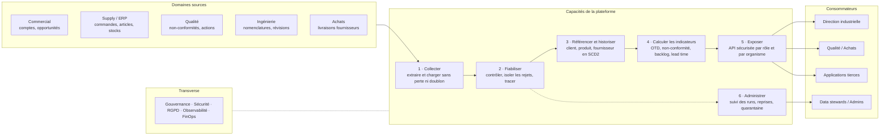
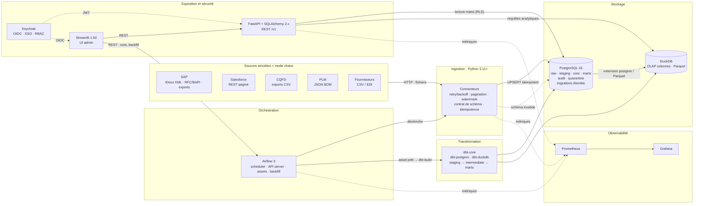
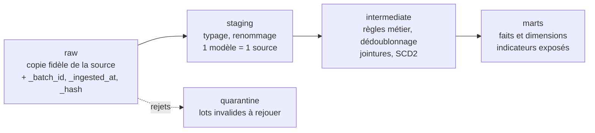

# Bull Data Lab — plateforme data industrielle, du design à la production

> Lab d'entraînement construit autour de la stack du poste **Data Engineer (F/H) – Bull, Les Clayes-sous-Bois**.
> Objectif : montrer une démarche de **builder** qui **anticipe** les problèmes à chaque couche, les **résout dans le code**
> et sait les **gérer en production** (détection, remédiation, runbook).

**Fil rouge métier** : une usine qui assemble des serveurs HPC. Les données commerciales (Salesforce), ERP (SAP),
qualité (CQFD), ingénierie (PLM) et fournisseurs sont consolidées pour piloter quatre indicateurs :
**OTD fournisseur**, **taux de non-conformité par produit/révision**, **backlog commandes** et **lead time commande → livraison**.

---

## Sommaire

1. [Architecture fonctionnelle](#1-architecture-fonctionnelle)
2. [Architecture technique](#2-architecture-technique)
3. [Stack et rôle de chaque couche](#3-stack-et-rôle-de-chaque-couche)
4. [Synthèse des problèmes par fonction](#4-synthèse-des-problèmes-par-fonction)
5. [Parcours du lab](#parcours-du-lab)
6. [Méthode : comment chaque problème est documenté](#6-méthode)

---

## 1. Architecture fonctionnelle

*Ce que fait la plateforme, indépendamment des technologies.*

| Capacité | Question métier à laquelle elle répond | Fonction technique |
|---|---|---|
| Collecter | « Ai-je reçu toutes les données, une seule fois ? » | [01 Ingestion](docs/problemes/01-ingestion.md) |
| Fiabiliser | « Puis-je faire confiance à ce chiffre ? » | [02 Transformation](docs/problemes/02-transformation.md) |
| Référencer / historiser | « Quelle était la révision du produit au moment de la non-conformité ? » | [02 Transformation](docs/problemes/02-transformation.md) · [03 Stockage](docs/problemes/03-stockage.md) |
| Calculer | « Quel est l'OTD du fournisseur X ce trimestre ? » | [02 Transformation](docs/problemes/02-transformation.md) · [03 Stockage](docs/problemes/03-stockage.md) |
| Exposer | « Qui a le droit de voir quoi ? » | [04 Exposition](docs/problemes/04-exposition.md) |
| Administrer | « Quel pipeline a échoué, comment je le relance ? » | [05 Infrastructure](docs/problemes/05-infrastructure.md) · [06 Gouvernance](docs/problemes/06-gouvernance-exploitation.md) |

---

## 2. Architecture technique

*Comment c'est construit : composants, flux et protocoles.*

**Plateforme d'exécution** : Docker Compose v2 (profiles `core`, `orchestration`, `security`, `observability`)
· Ubuntu en dev / SLES en cible prod · Git + GitHub Actions (lint, tests, `dbt build`, scans de sécurité).

### Flux de données (couches)

---

## 3. Stack et rôle de chaque couche

| Couche | Composants | Rôle |
| --- | --- | --- |
| **Sources** | SAP (IDocs, BAPIs, RFC ou exports fichiers), Salesforce, CQFD, PLM, flux fournisseurs | Données brutes |
| **Ingestion** | Pipelines ETL/ELT en Python | Extraction, chargement, gestion d'erreurs, idempotence |
| **Orchestration** | Airflow 3 | Planification, dépendances par assets, backfill |
| **Stockage transactionnel** | PostgreSQL 16 | Base de référence, schémas migrés avec Alembic |
| **Moteur analytique** | DuckDB (OLAP, colonnes) | Requêtes analytiques rapides |
| **Transformation** | dbt-core avec dbt-postgres et dbt-duckdb | Couches staging, intermediate et marts |
| **API** | FastAPI (Python 3.11+) et SQLAlchemy 2.x | Exposition REST |
| **Sécurité** | Keycloak | SSO et RBAC |
| **UI admin** | Streamlit 1.50 | Pages d'administration |
| **Exécution** | Docker Compose v2 | Conteneurisation |
| **Plateforme** | Linux (SLES en production, Ubuntu en développement), Git/GitHub Enterprise, CI/CD | Livraison et exploitation |
| **Observabilité** *(ajout du lab)* | Prometheus, Grafana, logs JSON | Métriques, alertes, tableaux de bord |

---

## 4. Synthèse des problèmes par fonction

Chaque problème renvoie vers une **fiche détaillée** (causes, prévention, détection, remédiation en production)
et vers l'**étape du lab** qui le reproduit et le résout.

### 01 · Ingestion – ETL/ELT Python → [fiche complète](docs/problemes/01-ingestion.md)

| ID | Problème | Réponse clé | Lab |
|---|---|---|---|
| [ING-01](docs/problemes/01-ingestion.md#ing-01) | Fiabilité des chargements : doublons, pertes de données et non-idempotence | Clé naturelle + hash, `UPSERT`, `batch_id`, rapprochement des volumes | [Étape 3](#parcours-du-lab) |
| [ING-02](docs/problemes/01-ingestion.md#ing-02) | Erreurs des sources : timeouts, API indisponibles, pagination incomplète, 429 | Retry avec backoff + jitter, `Retry-After`, circuit breaker, checkpoint de curseur | [Étapes 2-3](#parcours-du-lab) |
| [ING-03](docs/problemes/01-ingestion.md#ing-03) | Mises à jour : CDC, suppressions, événements désordonnés, données tardives | Watermark avec chevauchement, soft delete, `event_time` vs `ingested_at`, dernier état gagne | [Étape 3](#parcours-du-lab) |
| [ING-04](docs/problemes/01-ingestion.md#ing-04) | Reprises : backfill, retries, collisions avec les chargements courants | Advisory locks par partition, backfill Airflow isolé, chargements rejouables | [Étapes 3-4](#parcours-du-lab) |
| [ING-05](docs/problemes/01-ingestion.md#ing-05) | Traçabilité des sources et détection des changements de schéma | Colonnes techniques `_source/_batch_id/_hash`, contrat Pydantic, quarantaine | [Étape 3](#parcours-du-lab) |

### 02 · Transformation – dbt → [fiche complète](docs/problemes/02-transformation.md)

| ID | Problème | Réponse clé | Lab |
|---|---|---|---|
| [TRF-01](docs/problemes/02-transformation.md#trf-01) | Qualité : complétude, unicité, validité, cohérence, fraîcheur | Tests dbt génériques et métier, `source freshness`, sévérité warn/error | [Étape 6](#parcours-du-lab) |
| [TRF-02](docs/problemes/02-transformation.md#trf-02) | Cohérence métier : règles, référentiels, mappings, définitions des KPI | Seeds de mapping versionnés, KPI définis une seule fois, unit tests dbt | [Étape 6](#parcours-du-lab) |
| [TRF-03](docs/problemes/02-transformation.md#trf-03) | Modélisation : grain, historisation SCD2, données tardives | Grain documenté et testé, snapshots, incrémental avec fenêtre de rattrapage | [Étape 6](#parcours-du-lab) |
| [TRF-04](docs/problemes/02-transformation.md#trf-04) | Tests et évolutivité : changements de schéma, dépendances | Contrats de modèles, versions de modèles, slim CI `state:modified+` | [Étapes 1, 6](#parcours-du-lab) |
| [TRF-05](docs/problemes/02-transformation.md#trf-05) | Traçabilité : lineage, documentation, analyse d'impact | dbt docs, `exposures`, métadonnées `owner/pii` | [Étapes 6, 9](#parcours-du-lab) |

### 03 · Stockage – PostgreSQL / DuckDB → [fiche complète](docs/problemes/03-stockage.md)

| ID | Problème | Réponse clé | Lab |
|---|---|---|---|
| [STO-01](docs/problemes/03-stockage.md#sto-01) | Intégrité : doublons, versions contradictoires, pas de source de vérité | Postgres = source de vérité, contraintes en base, DuckDB en lecture seule | [Étape 5](#parcours-du-lab) |
| [STO-02](docs/problemes/03-stockage.md#sto-02) | Performance : requêtes coûteuses, jointures, scans complets, saturation | `pg_stat_statements`, `EXPLAIN ANALYZE`, analytique déportée sur DuckDB | [Étape 5](#parcours-du-lab) |
| [STO-03](docs/problemes/03-stockage.md#sto-03) | Partitionnement, indexation, rétention, archivage | Partitions mensuelles, index justifiés, archivage Parquet, `DETACH PARTITION` | [Étape 5](#parcours-du-lab) |
| [STO-04](docs/problemes/03-stockage.md#sto-04) | Sécurité : chiffrement, contrôle d'accès, données sensibles | Rôles à moindre privilège, RLS, pgcrypto, TLS | [Étape 5](#parcours-du-lab) |
| [STO-05](docs/problemes/03-stockage.md#sto-05) | Résilience : sauvegardes, restauration, réplication | Archivage WAL + PITR, test de restauration automatisé, RPO/RTO mesurés | [Étapes 5, 10](#parcours-du-lab) |

### 04 · Exposition – FastAPI / SQLAlchemy / Keycloak → [fiche complète](docs/problemes/04-exposition.md)

| ID | Problème | Réponse clé | Lab |
|---|---|---|---|
| [API-01](docs/problemes/04-exposition.md#api-01) | Sécurité des accès : authentification, RBAC, gestion des comptes | Validation JWT (JWKS, `aud`, `exp`), rôles Keycloak → dépendances FastAPI | [Étape 7](#parcours-du-lab) |
| [API-02](docs/problemes/04-exposition.md#api-02) | Sécurité des échanges : chiffrement, secrets, injections | TLS, secrets hors code, requêtes paramétrées SQLAlchemy, validation Pydantic | [Étape 7](#parcours-du-lab) |
| [API-03](docs/problemes/04-exposition.md#api-03) | Fiabilité : versionnage, pagination, erreurs standardisées, disponibilité | `/v1`, pagination par curseur, RFC 9457, `/health` et `/ready` | [Étape 7](#parcours-du-lab) |
| [API-04](docs/problemes/04-exposition.md#api-04) | Protection : rate limiting, timeouts, volumes sortants | Limites par client, `statement_timeout`, taille de page plafonnée | [Étape 7](#parcours-du-lab) |
| [API-05](docs/problemes/04-exposition.md#api-05) | Gouvernance des accès : traçabilité, isolation des organismes, droits | Journal d'audit, claim `org_id` → RLS Postgres | [Étapes 5, 7](#parcours-du-lab) |
| [API-06](docs/problemes/04-exposition.md#api-06) | Conformité : minimisation des données, RGPD | Schémas de réponse par rôle, masquage, finalité documentée | [Étape 7](#parcours-du-lab) |

### 05 · Infrastructure – Docker / CI/CD / Git → [fiche complète](docs/problemes/05-infrastructure.md)

| ID | Problème | Réponse clé | Lab |
|---|---|---|---|
| [INF-01](docs/problemes/05-infrastructure.md#inf-01) | Déploiement : séparation dev/prod, migrations Alembic, tests, rollback | Images immuables taguées, migrations *expand/contract*, rollback testé en CI | [Étape 1](#parcours-du-lab) |
| [INF-02](docs/problemes/05-infrastructure.md#inf-02) | Résilience : saturation CPU/RAM/disque, redémarrage des services | Limites de ressources, healthchecks, politique de redémarrage, alertes disque | [Étapes 1, 10](#parcours-du-lab) |
| [INF-03](docs/problemes/05-infrastructure.md#inf-03) | Sécurité : secrets, vulnérabilités, dépendances, chaîne CI/CD | gitleaks, pip-audit, trivy, dépendances verrouillées, moindre privilège CI | [Étape 1](#parcours-du-lab) |
| [INF-04](docs/problemes/05-infrastructure.md#inf-04) | Sauvegarde et reprise : PRA, RPO/RTO, tests de restauration | Exercice de PRA scripté et chronométré | [Étape 10](#parcours-du-lab) |
| [INF-05](docs/problemes/05-infrastructure.md#inf-05) | Maîtrise des coûts : ressources, stockage, optimisation | Profiles Compose, incrémental, rétention, mesure par run | [Étapes 1, 9](#parcours-du-lab) |

### 06 · Gouvernance, monitoring et exploitation → [fiche complète](docs/problemes/06-gouvernance-exploitation.md)

| ID | Problème | Réponse clé | Lab |
|---|---|---|---|
| [GOV-01](docs/problemes/06-gouvernance-exploitation.md#gov-01) | Observabilité : logs centralisés, métriques, alertes | Logs JSON + `correlation_id`, Prometheus/Grafana, alertes symptomatiques | [Étape 9](#parcours-du-lab) |
| [GOV-02](docs/problemes/06-gouvernance-exploitation.md#gov-02) | Anomalies : volumes inhabituels, échecs silencieux, accès suspects | Contrôles de volume vs historique, alerte « 0 ligne », détection sur l'audit | [Étapes 4, 9](#parcours-du-lab) |
| [GOV-03](docs/problemes/06-gouvernance-exploitation.md#gov-03) | Gouvernance : data owners, catalogue, glossaire, lineage | Métadonnées dbt, glossaire versionné, owner par dataset | [Étape 9](#parcours-du-lab) |
| [GOV-04](docs/problemes/06-gouvernance-exploitation.md#gov-04) | Conformité : classification, audit, anonymisation, rétention, effacement RGPD | Tags `pii`, procédure d'effacement testée, purge automatisée | [Étapes 5, 9](#parcours-du-lab) |
| [GOV-05](docs/problemes/06-gouvernance-exploitation.md#gov-05) | Incidents : détection, investigation, preuves, plan de réponse | Runbooks, niveaux de sévérité, post-mortems sans recherche de coupable | [Étape 10](#parcours-du-lab) |
| [GOV-06](docs/problemes/06-gouvernance-exploitation.md#gov-06) | FinOps : coûts par pipeline, dataset et service | Table `audit.run_costs`, tableau de bord par pipeline | [Étape 9](#parcours-du-lab) |

---

## 5. Parcours du lab

Chaque étape = une branche, une PR et un tag `step-NN`. Les problèmes sont **reproduits** via le mode chaos des simulateurs,
puis **corrigés** et **prouvés** par un test.

| Étape | Contenu | Problèmes couverts | Statut |
|---|---|---|---|
| 0 · Cadrage | Architectures, modèle de données, ADR, synthèse des problèmes | Tous (vue d'ensemble) | ✅ ce README |
| 1 · Socle infra | Docker Compose, PostgreSQL 16 + Alembic, Makefile, CI GitHub Actions | INF-01 → INF-03, INF-05, TRF-04 | ⏳ |
| 2 · Simulateurs de sources | Faux SAP / Salesforce / CQFD / PLM / fournisseurs avec chaos réglable | ING-02 (reproduction) | ⏳ |
| 3 · Ingestion Python | Connecteurs idempotents, retry, CDC, quarantaine, audit | ING-01 → ING-05 | ⏳ |
| 4 · Orchestration Airflow 3 | DAGs, assets, pools, backfill, alertes | ING-04, GOV-02 | ⏳ |
| 5 · Stockage | Schémas, partitions, index, RLS, sauvegardes, DuckDB | STO-01 → STO-05, API-05 | ⏳ |
| 6 · dbt | staging / intermediate / marts, tests, snapshots SCD2, contrats | TRF-01 → TRF-05 | ⏳ |
| 7 · API | FastAPI, SQLAlchemy 2, Keycloak, RBAC, audit | API-01 → API-06 | ⏳ |
| 8 · UI admin | Streamlit : runs, backfill, quarantaine, qualité | ING-04, ING-05, GOV-02 | ⏳ |
| 9 · Observabilité et gouvernance | Logs, métriques, catalogue, RGPD, FinOps | GOV-01 → GOV-04, GOV-06 | ⏳ |
| 10 · Game days | Incidents rejouables + runbooks + post-mortems | INF-02, INF-04, STO-05, GOV-05 | ⏳ |

---

## 6. Méthode

Chaque problème des fiches [`docs/problemes/`](docs/problemes/) suit la même structure :

| Rubrique | Contenu |
|---|---|
| **Symptômes en production** | Ce que l'on observe quand le problème survient |
| **Causes racines** | Pourquoi il arrive |
| **Prévention (design)** | Ce qui est construit pour qu'il n'arrive pas |
| **Détection** | Requête, métrique ou alerte qui le révèle |
| **Remédiation en production** | Runbook : quoi faire quand il arrive malgré tout |
| **Dans le lab** | Étape, scénario chaos et test qui le prouvent |
